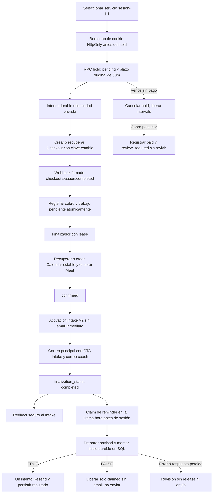

# Stripe Checkout local / Test Mode

Implementación Stripe Test Mode con aplicación local y Supabase local o ER_COACHING
controlado. No habilita Live Mode. Los scripts no aplican SQL remoto. Las pruebas
SQL automatizadas usan PostgreSQL temporal; el E2E manual usó ER_COACHING con
las migraciones aplicadas mediante autorización explícita. No se ha leído `.env.local`.

## Actualización UX preparada localmente

La nueva migración `20261029012540_decouple_intake_email_from_finalization.sql`
todavía NO está aplicada. Es la única cuarta migración; no hay una quinta ni
cambios en las tres aplicadas. Revisada antes de aplicación: reminder relativo al
horario actual de la sesión, URLs canónica/redirect separadas y protocolo durable
claim → marcar inicio en SQL → enviar. Desacopla el email del intake de la
finalización. El código actualizado requiere revisar y
autorizar esa migración antes de arrancarlo contra ER_COACHING.
Ver [contratos, flujo y preflight pendiente](stripe-public-ux.md).
Los resultados manuales siguientes corresponden al flujo anterior; el nuevo
UX todavía necesita E2E después del preflight remoto.

El preflight debe confirmar ausencia de las tres nuevas RPCs
`claim_stripe_intake_reminder_v1()`,
`mark_stripe_intake_reminder_dispatch_started_v1(uuid, uuid, timestamptz, timestamptz)`
y `release_unstarted_stripe_intake_reminder_v1(uuid, timestamptz)`, además de
owner, grants y `search_path`. Usa los campos existentes; no añade columnas.

El claim guarda `ready_email_error='reminder_claimed_not_started'` y
`bookings.stripe_intake_email_started_at`; devuelve ese nonce y
`expected_starts_at`. El worker prepara el payload sin llamar al proveedor.
La RPC de marcado recibe booking, form, nonce y starts_at esperado; bajo locks
valida pago Stripe, confirmación/finalización, form/FK, estado activo, submission,
expiración, el horario exacto y la ventana `[starts_at - 1h, starts_at)`.
Solo TRUE permite contactar a Resend: antes queda persistido
`ready_email_error='reminder_delivery_pending_or_unknown'` con el mismo timestamp.
FALSE permite intentar liberar la fase claimed y nunca enviar. Un error o
respuesta perdida del marcado no permite release ni envío, porque podría haber
commit.

Release usa CAS y comprueba la fuente Stripe/booking y ausencia de email. Puede
limpiar la fase no iniciada tras cancelación, submission, expiración o cambio de
starts_at. SQL rechaza categóricamente liberar dispatch pending, enviado, terminal
o ambiguo, incluso con una llamada directa posterior a Resend. Un error de
preparación de payload queda como terminal predispatch, sin retry. Una caída
antes del marcado conserva el claim para revisión manual, sin lease automático;
después del marcado conserva la entrega pendiente o desconocida incluso si aún
no contactó a Resend. Una caída tras Resend o un fallo al guardar el resultado
tampoco habilitan redispatch. Máximo un intento automático de red por reminder,
sin retry de rechazo determinístico y con clave estable `intake-ready/<form_id>`.

Una cancelación, submission, reprogramación o inicio de sesión simultáneos después
del marcado pueden coincidir con un único email en curso; nunca habilitan dos.
Estas reglas pertenecen al reminder. El correo principal conserva su recuperación
con payload canónico estable, incluso si el intake pasa de active a submitted.

## Resultados manuales verificados — 28-10-2026

| Prueba | Resultado |
| --- | --- |
| Happy path: pago, webhook, Calendar/Meet, emails, Intake V2 y finalización | VERIFIED |
| Replay/idempotencia con baseline exacto | VERIFIED |
| Tarjeta rechazada, sin pago ni efectos posteriores | VERIFIED |
| Hold de 30 minutos, checkout.session.expired y liberación de horario | VERIFIED |
| Backoff del worker con comparación de timestamps | VERIFIED |
| Fallo determinístico → attempt failed/rejected → successor nuevo | VERIFIED |
| Pago del successor y finalización | RECOVERED PAYMENT FUNCTIONALLY VERIFIED |

Limitaciones documentales: no se capturó la huella exacta de la Checkout Session
del successor antes del pago; no se contó directamente la cantidad de eventos en
Google Calendar. Supabase confirmó Calendar ID y Meet. Estas limitaciones no son
fallos funcionales ni requieren repetir el E2E.

La inyección temporal de fallo fue retirada del runtime. No hay variable aceptada
para activarla; la cobertura equivalente vive solo en tests. Ver
[resultado failed → successor](stripe-failed-retry-e2e.md),
[política de reconciliación](stripe-expiration-reconciliation.md) e
[inventario para revisión](stripe-review-inventory.md).

Las tres migraciones Stripe de esta ronda están aplicadas en ER_COACHING y no
deben reaplicarse. Las instrucciones de esquema siguientes son referencia de
contrato/preflight y preparación de bases locales nuevas.

## Arquitectura



`payment_status` refleja el pago aplicado; `status` refleja ocupación y
confirmación operativa. `finalization_status` admite `not_started`, `pending`,
`processing`, `completed`, `retryable`, `review_required`. Las nuevas columnas
son nullable para no clasificar ni expirar reservas históricas.

Un cobro con importe/moneda/identidad inconsistentes se conserva en el intento
(`payment_received_at`, importes y moneda recibidos), pero no se aplica como
pago completo del booking: queda en revisión. Un pago válido recibido después
de cancelar sí se registra `paid`, manteniendo el booking cancelado y en revisión.
No hay reembolso automático ni se asigna `refunded` por solicitarlo.

## Identidad estable y fingerprint

La identidad de negocio Stripe es **`services.slug = 'sesion-1-1'`**, junto con
`service_type = 'single'`, `booking_enabled = true`, `active = true`,
`requires_quote = false`, `session_count = 1`, duración positiva y precio positivo
en MXN representable exactamente en centavos y dentro del límite entero seguro.
La RPC valida este contrato en el servidor. BookingFlow selecciona la rama Stripe
por slug, tipo y número de sesiones; la ruta legacy también protege ese slug.
`services.name` solo alimenta snapshots, presentación y `product_data.name`.
Renombrarlo no impide crear el hold ni preparar el line item de Checkout.

Intake V2 usa la misma identidad estable mediante `bookings.service_id` →
`services.id`: slug `sesion-1-1`, tipo `single` y `services.session_count = 1`.
Excluye bookings con `process_id` o `package_session_number` presentes y conserva
`coalesce(session_count_snapshot, 1) = 1` para snapshots históricos. No usa ningún
nombre visible para decidir elegibilidad. `service_name_snapshot` se conserva
sin cambios y se devuelve para presentación, historial y emails, aunque el
catálogo tenga ahora otro nombre.

En esta operación no se exige `active` ni `booking_enabled`: despublicar un
servicio después de reservar no invalida una compra ni su intake. Cambiar slug,
tipo o número de sesiones sí cambia la elegibilidad; una referencia al servicio
ausente/nula falla sin recurrir al nombre como alternativa. No se hace backfill
automático de reservas históricas sin `service_id`.

El fingerprint de la RPC usa SHA-256 nativo (`pg_catalog.sha256(bytea)`), sin
instalar extensiones. Se calcula sobre un array JSONB con slug y nombre con
`btrim`, correo con `lower(btrim(...))`, teléfono/notas con
`nullif(btrim(...), '')` y el instante `starts_at` como epoch numérico exacto,
incluidos microsegundos. Es independiente de la zona horaria de la conexión.
No se convierte el nombre a minúsculas ni se elimina whitespace interior.
Los mismos valores normalizados se entregan a `create_booking`. Este checksum
solo comprueba igualdad lógica: **no es una credencial de autenticación**.
El hash de la clave de coordinación del navegador es independiente de este
fingerprint SQL y tampoco autoriza acceso.
Referencia: [SHA-256 nativo de PostgreSQL 17](https://www.postgresql.org/docs/17/functions-binarystring.html).

## Migración y revisión manual previa

Archivo completo: `supabase/migrations/20261028000100_stripe_test_booking_lifecycle.sql`.
Ya aplicada a ER_COACHING mediante autorización explícita. No reaplicarla ni ejecutarla automáticamente.

Corrección posterior de intake:
`supabase/migrations/20261028000200_intake_v2_stable_service_identity.sql`.
Reemplaza únicamente `activate_booking_intake_v2` y conserva su firma de cinco
argumentos, columnas de retorno, SECURITY DEFINER, search_path fijo y permisos
exclusivos de service_role. No añade columnas/tablas ni modifica la lógica
financiera, el lock del booking, paid_at, tokens, emails o intake existente.
La migración histórica `20261027000100_activate_booking_intake_v2.sql` queda
intacta: en bases nuevas se aplica el historial en orden; en una instancia que
ya tiene V2, la corrección se revisa y aplica por separado de forma manual.
En esta ronda solo se ejecuta dentro de PostgreSQL temporal de tests.

La migración anterior de intake V2 debe estar revisada y disponible primero.
La nueva RPC es un wrapper transaccional de `create_booking`: reutiliza sus
settings, validación de disponibilidad, snapshots, referencia e INSERT.
No modifica `create_booking`, `create_package_booking`, `create_process_session`,
`get_available_slots` ni `bookings_no_overlap`.

Los cuerpos reales completos de las RPC no están versionados: la fixture de
tests representa el contrato confirmado por el usuario, no una copia del esquema
real. Antes de aplicar manualmente sobre una copia LOCAL del esquema real,
inspeccionar tipos/defaults, firmas y constraints con estas consultas:

```sql
SELECT table_name, column_name, data_type, udt_name, is_nullable, column_default
FROM information_schema.columns
WHERE table_schema = 'public' AND table_name IN ('bookings','services')
ORDER BY table_name, ordinal_position;

SELECT p.oid::regprocedure AS signature, pg_get_functiondef(p.oid)
FROM pg_proc p JOIN pg_namespace n ON n.oid=p.pronamespace
WHERE n.nspname='public' AND p.prokind='f' AND p.proname IN (
  'create_booking','create_package_booking','create_process_session',
  'get_available_slots','activate_booking_intake_v2'
);

SELECT conname, contype, condeferrable, pg_get_constraintdef(oid)
FROM pg_constraint WHERE conrelid='public.bookings'::regclass;
```

El preflight se ejecuta antes de crear columnas, tablas o RPC Stripe. Comprueba:

- Firma exacta mediante
  `to_regprocedure('public.create_booking(text,timestamp with time zone,text,text,text,text)')`.
  Una función con el mismo nombre y otros argumentos no es suficiente.
- Existencia y tipos de `bookings.id`/`service_id` (UUID),
  `created_at`/`starts_at`/`ends_at` (timestamptz), `status`/`payment_status`,
  `currency_snapshot`/`booking_reference` (text o varchar),
  `price_snapshot` (numeric o entero; rechaza tipos de coma flotante).
- `created_at NOT NULL` y default reconocido de fecha actual: `now()`,
  `CURRENT_TIMESTAMP` con precisión opcional, `transaction_timestamp()`,
  `statement_timestamp()` o `clock_timestamp()`. Un default nulo, ausente,
  constante o personalizado exige revisión humana; no se inventa uno nuevo.
- SHA-256 nativo disponible, firma de intake V2 y constraint de exclusión
  `bookings_no_overlap` presentes.

Un contrato inesperado aborta la transacción con un error que pide revisión.
No se reparan tipos/defaults ni se modifica `create_booking`. El preflight es
conservador (por ejemplo, no acepta automáticamente domains o enums) y no
sustituye la revisión de cuerpos, argumentos nombrados, defaults y constraints
del esquema LOCAL real.

Tablas nuevas:

- `booking_payment_attempts`: historial, importe en unidad mínima, moneda,
  sesión/PaymentIntent, payload inmutable, lease y recepción financiera.
- `stripe_events`: identidad del evento, objeto, booking, resultado y trazabilidad;
  no se almacena el payload completo ni datos de tarjeta.

Índices: sesión y PaymentIntent únicos cuando no son nulos; un intento activo por
booking en `creating/open/unknown`; credencial de booking única; búsquedas de
expiración y finalización. RLS en tablas nuevas, sin políticas públicas y sin
grants para anon/authenticated. RPCs SECURITY DEFINER con search_path fijo,
ejecutables por service_role. No hay índices que dependan de `now()`.

RPCs nuevas:

1. `create_stripe_booking_hold_v1`
2. `claim_stripe_checkout_v1`
3. `save_stripe_checkout_v1`
4. `expire_stripe_booking_hold_v1`
5. `apply_stripe_checkout_event_v1`
6. `claim_stripe_finalization_v1`
7. `save_stripe_finalization_v1`

## Plazo de 30 minutos y decisión aceptada

El usuario decidió conservar exactamente `created_at + interval '30 minutes'`.
Stripe exige al menos 30 minutos **desde crear la Session**, por lo que no es
posible usar literalmente el deadline anterior después de crear el booking.
La Session usa un vencimiento automático posterior (deadline del hold + 1h),
almacenado una sola vez en el payload. El worker solicita su expiración al
vencer el hold original. No se renueva ningún deadline por visitas o retries.

Referencia oficial: https://docs.stripe.com/api/checkout/sessions/create

**Mantener el worker local activo.** Sin scheduler productivo, con Next/worker
detenidos, o si Stripe no responde, no puede garantizarse cerrar remotamente
Checkout exactamente al segundo 1800. La base rechaza aplicar un pago a un hold
vencido y lo conserva para revisión; el cleanup posterior libera el horario.
También hay limpieza al crear un hold. Las sesiones desconocidas mantienen el
intento activo y se recuperan con el payload/clave originales mientras el hold
siga vigente. Después del deadline la conciliación es de solo lectura mediante
listado/recuperación de sesiones; nunca llama a `create`, ni siquiera con la clave
original, porque podría crear una sesión si la primera solicitud nunca llegó.

La migración `20261028201527_stripe_failed_attempt_recovery.sql` ya está aplicada
y su estructura verificada en ER_COACHING; no reaplicarla. Un fallo probado conserva su attempt `failed` y
permite un único sucesor dentro del hold original. Los intentos ambiguos nunca se
reemplazan. Ver [contrato y pruebas de recuperación](stripe-deterministic-errors.md).
El reconciliador local añade [backoff y escalamiento finito](stripe-expiration-reconciliation.md)
con campos existentes, sin otra migración ni reparación de históricos.

Si el pago ya está registrado, el expirador no cancela. Si gana la expiración,
el pago posterior no crea Calendar, Meet, intake ni correo de confirmación.
Salir por `cancel_url` no cancela anticipadamente: permite volver a la misma URL.
El enlace explícito “Seleccionar un horario nuevamente” comienza un flujo nuevo
después de una cancelación; no modifica el hold anterior.

## Configuración manual, únicamente nombres

Variables nuevas:

```dotenv
STRIPE_SECRET_KEY=
STRIPE_WEBHOOK_SECRET=
NEXT_PUBLIC_SITE_URL=
STRIPE_LOCAL_WORKER_SECRET=
```

Se reutilizan las variables existentes de Supabase, Google, Resend e intake.
La integración permite Supabase de loopback o exclusivamente el origen HTTPS
`rysgpojjhiljrrwtjguy.supabase.co` (ER_COACHING). La aplicación sigue exigiendo
HTTP de loopback; rechaza claves `sk_live` y eventos `livemode=true`.
Solo acepta el contrato del slug `sesion-1-1` descrito arriba.
No crea productos Stripe manuales: utiliza `price_data` server-side.

Preparar manualmente una base Supabase LOCAL con una copia revisada del esquema
y datos ficticios. No copiar clientes, claves, refresh tokens ni datos reales.
No usar las fixtures de tests como esquema completo de la aplicación.

Para la prueba manual, cargar solo configuración de pruebas en el proceso de
Next: no ejecutar contra la configuración de producción existente. El usuario
puede preparar un archivo ignorado `.env.stripe-test` con esos datos locales y
de sandbox. Node puede precargarlo con `--env-file` (no modificar `.env.local`).
Abrir la aplicación con el mismo hostname y puerto de `NEXT_PUBLIC_SITE_URL`.

Google/Resend deben conectarse manualmente a cuentas/destinatarios de prueba.
Las pruebas automatizadas NO llaman a estas APIs: usan dobles aislados.
Si faltan esas integraciones, el pago queda guardado y la finalización reintentable.

## Prueba manual con Stripe CLI

Para ER_COACHING remoto, usar `node scripts/dev-stripe-test.mjs --check` antes
de arrancar. El script lee únicamente `.env.stripe-test`, informa nombres faltantes
sin valores y verifica una copia temporal sin archivos `.env*` ni symlinks de origen.
`node scripts/dev-stripe-test.mjs` ejecuta Next en esa copia, con entorno filtrado,
hostname localhost y puerto 3000. No usar el comando directo de Next: cargaría
automáticamente los archivos de entorno del repositorio. La copia se elimina al salir.
No se copian credenciales automáticamente desde otros archivos.

Además de las cuatro variables Stripe, completar manualmente:
`NEXT_PUBLIC_SUPABASE_URL`, `NEXT_PUBLIC_SUPABASE_PUBLISHABLE_KEY`,
`SUPABASE_SECRET_KEY`, `GOOGLE_CLIENT_ID`, `GOOGLE_CLIENT_SECRET`,
`GOOGLE_REDIRECT_URI`, `RESEND_API_KEY`, `RESEND_FROM_EMAIL`, `COACH_EMAIL`, `CONTACT_TO_EMAIL`,
`INTAKE_TOKEN_ENCRYPTION_KEY`. Google recupera el refresh token de la conexión
existente en la base; no requiere una variable adicional de refresh token.
La integración actual usa el calendario primary de Edna, sin incluir al cliente
como attendee y con sendUpdates=none. El cliente recibe el email principal propio;
confirmar los destinatarios de prueba antes del E2E. No cambiar la clave de cifrado
existente por una nueva para acceder a intakes históricos.

1. Usar el esquema local revisado o ER_COACHING autorizado. Las cuatro migraciones
   ya están aplicadas en ER_COACHING y su historial LOCAL/REMOTE está alineado;
   no reaplicarlas ni hacer db push. Seleccionar un horario futuro.
2. En una terminal, el usuario ejecuta `stripe login`. No automatizamos el login.
3. Ejecutar:

   ```sh
   stripe listen --events checkout.session.completed,checkout.session.expired --forward-to localhost:3000/api/webhooks/stripe
   ```

4. Guardar manualmente el secreto del listener en `STRIPE_WEBHOOK_SECRET` de la
   configuración de pruebas. No pegarlo en commits, chats, documentación o logs.
5. Arrancar Next con el entorno local de pruebas y el comando de desarrollo:

   ```sh
   node scripts/dev-stripe-test.mjs
   ```

6. En otra terminal, con el mismo archivo local y secreto del worker:

   ```sh
   node --env-file=.env.stripe-test scripts/stripe-local-worker.mjs
   ```

7. En `/reservar`, seleccionar Sesión 1:1 y horario. Completar los datos ficticios.
8. Tras ir a Checkout, inspeccionar manualmente la base local: booking pending,
   pago pending, flujo stripe, deadline fijo, intento único, sin Calendar/Meet,
   sin correos de confirmación ni intake.
9. Salir de Checkout, volver al estado y pulsar “Volver al pago”: debe recuperar
   la misma sesión. Recargar y abrir otra pestaña tampoco crea otro intento activo.
10. Pagar en Checkout con una tarjeta oficial de pruebas; observar el evento real
    `checkout.session.completed` que corresponde a ese hold. `stripe trigger`
    genera objetos genéricos que NO están vinculados a tu reserva y no son un
    sustituto de esta prueba de extremo a extremo.
11. Verificar pago paid y primero estado operativo pending; después Calendar/Meet,
    confirmed, correos, un intake y finalization completed. La vuelta del navegador
    no registra el pago; esperar el webhook y las actualizaciones de la página.
12. Reentregar **el mismo evento real de tu Session** usando su ID del listener:

    ```sh
    node --env-file=.env.stripe-test scripts/replay-stripe-test-event.mjs evt_ID_DE_TU_EVENTO
    ```

    Este script recupera el evento de la cuenta TEST mediante Stripe, rechaza
    live mode y vuelve a firmar el mismo payload/ID con el secreto del listener
    local antes de enviarlo a localhost. No crea otro pago ni otro evento y no
    imprime secretos/payload. Es una herramienta exclusiva de pruebas locales.
    No ejecutar `stripe trigger` como sustituto de este evento vinculado.
13. Comprobar IDs de Calendar y Meet, IDs de correo, intake/hash y número de filas:
    no deben cambiar ni duplicarse por el replay.
14. Abandonar otro Checkout y esperar 30 minutos con el worker activo: booking
    cancelled, razón payment_expired, slot nuevamente disponible.
15. Simular fallos en cuentas de prueba o usar las suites automatizadas para
    timeout Google, Meet pendiente, Resend fallido, intake fallido y carreras.

Tarjetas oficiales (solo escribirlas en Checkout Test Mode):

| Caso | Tarjeta |
| --- | --- |
| Éxito Visa | `4242424242424242` |
| Rechazo genérico | `4000000000000002` |
| Autenticación 3DS en sesión | `4000002500003155` |

Fecha futura y CVC de prueba. Fuente oficial, consultada el 28-10-2026:
https://docs.stripe.com/testing?testing-method=card-numbers

## Idempotencia y recuperación

| Caso | Protección |
| --- | --- |
| Doble clic | submitting + ref sin liberarlos durante redirect |
| Reload / misma persona | UUID públicos de coordinación en localStorage; credencial exclusiva de cookies HttpOnly; servidor guarda solo hash |
| Clientes distintos mismo horario | Exclusion constraint existente; exclusión/deadlock se traducen a conflicto controlado; el perdedor no llama a Stripe |
| Checkout duplicado | Intento activo único, lease de creación, payload y clave estables; desconocido no se reemplaza |
| Webhook duplicado | PK de evento y aplicación bajo bloqueo del booking, más identidad de Session/PaymentIntent |
| Pago contra expiración | Ambos bloquean el mismo booking y vuelven a comprobar sus condiciones |
| Calendar duplicado | ID derivado compatible con Google; recuperar antes de crear y después de timeout/409 |
| Meet pendiente | Recuperar el mismo evento, sin otra conferencia arbitraria |
| Correo principal/coach fallido | Reintentos por destinatario; no se anulan pago ni Calendar; claves y payload canónico estables |
| Resultado ambiguo de correo principal/coach | Tras 23h sin éxito persistido, revisión en vez de arriesgar reenvío fuera de la ventana de Resend |
| Reminder de intake | Claim y marcado durable bajo locks; un intento de red con clave `intake-ready/<form_id>`, sin retry de rechazo determinístico |
| Release de reminder | Solo claimed sin email con CAS y fuente Stripe/booking; SQL rechaza pending, enviado, terminal y ambiguo |
| Reminder marcado, crash o respuesta perdida | Revisión sin redispatch; después del marcado no se libera aunque el proveedor todavía no haya sido contactado |
| Intake fallido | V2 conserva fila/token; retry con la misma referencia; acceso inconsistente pasa a revisión |

### Credencial, cookies y coordinación entre pestañas

El secreto del hold es una cadena aleatoria de 32 bytes (64 caracteres hex),
generada **en el servidor**. Es distinto del token de intake. Nunca se entrega
en JSON, HTML, query params, metadata de Stripe, success_url o cancel_url.
**El secreto del hold nunca vive en localStorage.** Tampoco se guarda allí su
hash, enlaces de Checkout, tokens de intake ni secretos Stripe. Una referencia
de reserva, un ID de booking o una Session ID no autorizan acceso por sí solos.

El cliente envía un UUID público `flowId`. Si falta su cookie, el primer POST
devuelve solo `{requiresCookie: true}` y Set-Cookie, sin crear booking, intento ni
Checkout. El cliente repite automáticamente el POST bajo el mismo lock y el
navegador adjunta la cookie; JavaScript no lee el secreto. Tras crear/recuperar el
hold, la respuesta contiene solo ID público de booking y URL de Checkout.

| Lugar | Valor exacto | Uso y duración |
| --- | --- | --- |
| Cookie `booking_flow_<flowId>` | Secreto aleatorio de 64 hex | Bootstrap y retry del hold, Path `/api/bookings/stripe/checkout`, 2 horas desde bootstrap, sin renovación en retries |
| Cookie `booking_access_<bookingId>` | El mismo secreto | Recuperar Checkout y consultar confirmación, Path `/`, vencimiento fijo `payment_expires_at + 90 minutos` (2h desde creación del hold) |
| Base `booking_access_token_hash` | SHA-256 del secreto | Autenticación de RPC; nunca se devuelve al navegador |
| localStorage `edna-booking-flow/v2/request/<checksum-del-payload>` | UUID público del flujo | Identificar la misma solicitud entre recargas/pestañas |
| localStorage `edna-booking-flow/v2/booking/<flowId>` | UUID público del booking | Coordinar recuperación; requiere además cookie válida |

Las dos cookies son HttpOnly, SameSite=Lax y host-only (sin Domain). En HTTP local
usan Secure=false; el helper de flags usa Secure=true para una URL HTTPS. Esto
no habilita Stripe en producción: siguen activos los bloqueos de loopback/test.
Expires y Max-Age reflejan el mismo límite. Recuperar por booking no renueva la
cookie; reintentar el hold conserva el deadline original. El margen de 90 minutos
permite volver de Checkout pagado sin perder inmediatamente la confirmación.
Después de ese límite o si se borran cookies, se exige acceso válido: una
referencia pública no reconstruye la credencial. No se envía la credencial a Stripe.
El flujo legacy de paquetes conserva su duración previa de cookie de 7 días.

Web Locks serializa tanto la obtención del flowId como el bootstrap, los POST y
el guardado del ID público de booking entre pestañas. La siguiente pestaña usa
ese booking ID con la cookie compartida del navegador. Sin Web Locks, la
constraint de exclusión y los locks/índices SQL mantienen un único ganador;
una carrera de bootstrap puede requerir reintentar, sin crear dos holds activos.
Las entradas antiguas `edna-booking-flow/` se eliminan sin leer ni reutilizar
sus valores al preparar un nuevo envío. localStorage conserva únicamente los
identificadores públicos de coordinación en el namespace v2; se mantiene la
protección habitual frente a XSS, ya que HttpOnly no impide acciones desde XSS.

El finalizador usa lease de dos minutos y escrituras condicionadas a su propietario;
las llamadas HTTP quedan fuera de la transacción. El worker recupera leases
vencidos y pasos retryable. `after()` acelera el primer intento, pero no reemplaza
la cola durable representada por el estado del booking y el worker local.

## Pruebas y build sin configuración real

Requisitos: Node compatible con Next y PostgreSQL (`initdb`, `pg_ctl`, `psql`).

```sh
node --test --test-reporter=spec tests/*.test.mjs
node scripts/build-stripe-test.mjs
git diff --check
git status --short
```

El script de build copia el código a una carpeta temporal excluyendo `.env*`,
`.git`, caches y credenciales; reutiliza dependencias y ejecuta allí exactamente
`npm run build -- --webpack` con placeholders locales. Nunca abre `.env.local`.
Elimina únicamente su carpeta temporal al terminar.

Las pruebas cubren contratos SQL confirmados con PostgreSQL temporal y dobles de
Stripe/Google/Resend. Estas pruebas automatizadas no llaman a cuentas reales.
La ejecución y el total finales de la suite del protocolo durable, TypeScript,
build y SHA-256 de la cuarta migración quedan pendientes de registrar en
[la validación de esta revisión](stripe-public-ux.md#validación-local-de-esta-revisión).
La cobertura debe comprobar nonce/starts_at exactos, CAS, pago/finalización y
form/FK, cancelación/submission/expiración, marcado confirmado o ambiguo, caídas
antes/después del marcado y del proveedor, y rechazo SQL de release posterior al
marcado, entrega o estado terminal; ningún caso ambiguo puede hacer redispatch.
El E2E manual posterior sí verificó Stripe Test y las integraciones existentes en
ER_COACHING, según la tabla de resultados al inicio de este documento.

## Fuera de alcance y límites antes de producción

- Sin live mode, reembolsos automáticos, disputas, métodos diferidos o Stripe para paquetes.
- Sin scheduler productivo; detener el worker retrasa liberación y recuperación.
- La corrección de identidad de intake requiere revisar los `service_id`
  históricos y las columnas `services.slug/service_type/session_count` y
  `bookings.process_id/package_session_number` contra el esquema LOCAL real.
  Reservas sin identidad válida fallan sin alterar pago/intake. No hay fallback
  por nombre ni reparación automática de datos históricos.
- Gestión administrativa Stripe bloqueada en cancelación, reprogramación y pago
  manual. Así se evita mover el horario o registrar un pago alternativo mientras
  Checkout siga cobrable. La resolución manual futura no está implementada.
- Credenciales de confirmación de reservas anteriores no se reconstruyen:
  una referencia histórica sola muestra acceso no verificado, nunca falso éxito.
- Un evento que llegue antes de guardar la Session devuelve error recuperable
  para reentrega. Una identidad/importe inconsistentes se conserva para revisión.
- Cambiar branding, plantillas o datos de una reserva durante la ventana de retry
  puede hacer que Resend rechace la misma clave con payload diferente; no generar
  otra clave automáticamente.
- El E2E Test Mode y los preflights remotos están verificados. Live Mode y despliegue
  productivo siguen fuera de esta validación; requieren revisión separada.

No commit, push ni deploy.

## Registro histórico de la suite inicial (142 pruebas)

| Suite | Resultado |
| --- | --- |
| activate-booking-intake-v2.test.mjs | 29/29 |
| activate-booking-intake.test.mjs | 15/15 |
| stripe-postgres.test.mjs | 29/29 |
| stripe-preflight.test.mjs | 19/19 |
| stripe-public-flow.test.mjs | 16/16 |
| stripe-services.test.mjs | 34/34 |
| Total | 142/142; sin fallos, omitidos ni pendientes |

Se conservan las 93 pruebas anteriores, adaptando la coordinación del navegador
a IDs públicos en lugar de secretos. Se añaden 32 casos: nombre/slug y payload
de Checkout (3), normalización/fidelidad del fingerprint (3), contratos negativos
y positivos del preflight (19), bootstrap/credenciales/flags y ciclo de cookies,
precisión de timestamp y coordinación de pestañas (7). Se verifica que el secreto
y su hash no aparecen en HTML y que localStorage solo genera UUID públicos.
Las pruebas de firma/columnas/defaults fallidos comprueban además que no se hayan
creado tablas financieras ni columnas Stripe al abortar.

La corrección posterior de intake conserva las 125 pruebas anteriores y añade
17: quince de contrato/seguridad/identidad en PostgreSQL para V2, una de aplicación
transaccional de un evento Stripe simulado con snapshot renombrado y otra que
verifica la interfaz usada por `finalizePaidBooking()`. Las regresiones financieras
y concurrentes de V2 y Stripe se ejecutan ahora con la migración correctiva
aplicada. Los casos antiguos que clasificaban por nombre se adaptan al contrato
estable; un snapshot nulo o con otro nombre ya no es motivo de rechazo.

PostgreSQL local de pruebas: 16.13. La instancia confirmada por el usuario es
17.11, verificada READ-ONLY. Posteriormente se aplicaron las migraciones autorizadas
y se ejecutaron los E2E manuales documentados arriba.

`npm run build -- --webpack`: correcto, incluida comprobación TypeScript,
ejecutado mediante el script de copia saneada. Hubo avisos de contenido público
por `ECONNREFUSED 127.0.0.1:54321` al no haber Supabase local escuchando durante
el prerender; el build terminó con código 0. El primer intento dentro del sandbox
no pudo descargar Google Fonts; se repitió con el permiso de red solicitado.

`git diff --check`: sin incidencias. No se ha hecho stage, commit, push ni deploy.

## Inventario exacto de archivos de esta implementación

Modificados:

```text
.gitignore
src/app/api/admin/payments/mark-paid/route.ts
src/app/api/bookings/[id]/cancel/route.ts
src/app/api/bookings/[id]/reschedule/route.ts
src/app/api/bookings/route.ts
src/app/reservar/confirmada/page.tsx
src/app/reservar/page.tsx
src/components/publico/reservar/BookingFlow.tsx
src/lib/email/send-booking-emails.tsx
src/lib/google/calendar.ts
tests/activate-booking-intake.test.mjs
tests/activate-booking-intake-v2.test.mjs
.env.example
```

Creados:

```text
docs/stripe-local-test.md
scripts/build-stripe-test.mjs
scripts/replay-stripe-test-event.mjs
scripts/stripe-local-worker.mjs
src/app/api/bookings/stripe/checkout/route.ts
src/app/api/internal/stripe/process-pending/route.ts
src/app/api/webhooks/stripe/route.ts
src/components/publico/reservar/BookingStatusActions.tsx
src/lib/bookings/confirmation-state.ts
src/lib/bookings/finalize-paid-booking.ts
src/lib/stripe/access.ts
src/lib/stripe/browser-flow.ts
src/lib/stripe/checkout.ts
src/lib/stripe/errors.ts
src/lib/stripe/expire-hold.ts
src/lib/stripe/money.ts
src/lib/stripe/process-pending.ts
src/lib/stripe/server.ts
src/lib/stripe/webhook.ts
supabase/migrations/20261028000100_stripe_test_booking_lifecycle.sql
supabase/migrations/20261028000200_intake_v2_stable_service_identity.sql
tests/fixtures/stripe-local-schema.sql
tests/helpers/load-typescript.mjs
tests/helpers/local-postgres.mjs
tests/stripe-postgres.test.mjs
tests/stripe-preflight.test.mjs
tests/stripe-public-flow.test.mjs
tests/stripe-services.test.mjs
```

`.env.example` ya existía, pero estaba ignorado por `.env*`. Se añadieron solamente
los nombres vacíos de las variables nuevas y la excepción `!.env.example` en
`.gitignore`; `.env.local` continúa ignorado y no se ha leído ni modificado.
Git muestra 12 archivos versionados modificados y 29 sin seguimiento (incluida
la plantilla que antes estaba ignorada). Las migraciones históricas permanecen intactas.

## Archivos de la ronda de endurecimiento Stripe (125 pruebas)

Se ajustan únicamente estos 12 archivos de la implementación existente:

```text
supabase/migrations/20261028000100_stripe_test_booking_lifecycle.sql
src/app/api/bookings/route.ts
src/app/api/bookings/stripe/checkout/route.ts
src/components/publico/reservar/BookingFlow.tsx
src/lib/stripe/access.ts
src/lib/stripe/browser-flow.ts
tests/fixtures/stripe-local-schema.sql
tests/helpers/local-postgres.mjs
tests/stripe-postgres.test.mjs
tests/stripe-public-flow.test.mjs
tests/stripe-services.test.mjs
docs/stripe-local-test.md
```

Se crea `tests/stripe-preflight.test.mjs`. La fixture incorpora el `service_id`
necesario para probar el contrato exigido. El helper de PostgreSQL recoge la
salida de psql incluso cuando `ON_ERROR_STOP` cierra stdin antes de terminar de
recibir una migración deliberadamente inválida (EPIPE).
En esa ronda no se modificó intake V2, las invitaciones ni los pasos del finalizador.

## Archivos de la corrección de identidad de intake

Nueva migración:
`supabase/migrations/20261028000200_intake_v2_stable_service_identity.sql`.

Modificados: `tests/activate-booking-intake-v2.test.mjs`,
`tests/stripe-postgres.test.mjs`, `tests/stripe-services.test.mjs` y este documento.
La fixture de V2 incorpora servicios y sus asociaciones con bookings; la migración
no altera tablas existentes. El código TypeScript de producción, Stripe, cookies,
Calendar/Meet, emails e invitaciones permanece intacto en esta corrección.
